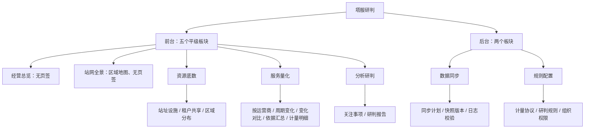
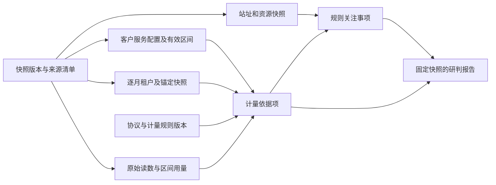

# 塔服研判：页面级产品设计方案 V1.0

2026-11-13 Launcher收尾：第三行调整为“资源底数／数据更新／报告中心”，数据更新沿用日常工具工作台及聚合处理，不增加第八个分析业务板块。业务待迁移区删除，未建规划只保留文档记录；已有页面及功能不删除，配置管理不受影响。详见[门户信息结构](50-information-architecture.md)。

2026-11-13现行入口以七大业务板块为准，详见[门户信息结构](50-information-architecture.md)。区域分布已迁入“分析研判 → 区域对比”，从待迁移移除；复用原 `/tower-service/network` 的地图、资源／服务／共享率、基期比较、区域对照和下钻，地域统一Header。下文旧“站网全景”统计页内容归该专题；站网全景一级入口继续为独立全画布地图。

2026-11-13运行监测入口调整：分析组按“运行监测／服务量化／分析研判”排列，运行监测关联现有 `/monitoring`，从待迁移区移除重复项，原页面功能及参数保留。当前可见前台入口为六个，服务量化仍包含五个二级页面。

2026-11-13服务量化合并：计量依据归入服务量化，统一 `/tower-service/services`，二级页面为“按运营商／周期变化／变化对比／依据汇总／计量明细”。Launcher不再设置独立计量依据入口。原 `/tower-service/evidence` 及原查询参数兼容跳转；原口径对照仍跳至配置管理。两个统计模型保留各自边界，数量不变、依据不补造。数量点击携带同快照、区域、运营商、服务进入计量明细；返回保留原分析条件及本标签页的展开、列表／卡片和滚动位置。协议、规则及版本配置继续属于配置管理。

2026-11-13早先导航定位记录（区域归属已由首段覆盖）：站网全景主入口为现有全屏站网地图 `/product-preview?hour=18`；原 `/tower-service/network` 当时改名“区域分布”并暂列原有功能（待迁移）。现已迁入“分析研判 → 区域对比”，原能力与深链继续可用。

2026-11-12 页面细化覆盖：服务量化「变化对照」采用运营商对比条目，而非基期／本期独立表格列。每条集中呈现基期→本期精确数值和共用数量标尺（本期横条、基期刻度），右侧将增减量和幅度合为一组。保留大运营商图标、单位、集中期间说明与数值追溯；删除本页运营商选择，保留指标和比较方式。所有条目使用同一最大值，不将不同单位或规格合并，不增加业务优劣色判断。

日期：2026-11-10。产品全称：铁塔运营商服务量化与研判平台；简称：塔服研判。

状态：本PRD为目标权威，取代[原定位100](100-site-service-analysis.md)中与本次要求冲突的服务履行、故障及SLA等方向。按[T01–T08迁移计划](../70-workplan/70-tower-service-migration-batches.md)，**八批本地验收完成（8/8）**，现行五前台、两后台及主入口已落实；[T08验收291](../40-implementation/ops_bsmoss_291_t08-navigation-acceptance.md)包含19视图回归、最终迁移矩阵、兼容回退及来源／业务待确认清单。原页面、规则、快照、报告及历史保留，不改变旧语义。正式快照来源、具体客户服务、月度租户／锚定、表计绑定／协议、生产存储与组织授权仍待接入／确认，本地演示不是投产。各批细节保留在284–290实施记录；[旧五阶段](../70-workplan/60-site-service-batches.md)阶段1–3成果保留，未实施4／5的原排期由T计划替代。本轮结束，不新增T09。

## 1. 信息架构

前台共13个主视图，后台共6个配置／管理视图；详情抽屉、报告阅读及规则编辑不新增一级入口或页签。保留四字名称“服务量化”“分析研判”：前者覆盖按客户、构成和期间量化，后者覆盖关注事项与有据判断。若后续采用“服务清单”“决策研判”，只调整导航文案，不改变职责。

### 1.1 产品目标与职责

| 核心问题 | 主板块 | 输出 |
|---|---|---|
| 我们有什么 | 资源底数；站网全景为空间入口 | 站址、设施、租户共享及区域底数 |
| 给运营商提供了什么 | 服务量化（含计量依据） | 按运营商、服务类别和期间的数量与用量，附适用口径 |
| 下一步关注和解决什么 | 分析研判；经营总览给摘要 | 可解释关注事项、涉及范围、建议核查方向、研判报告 |

经营总览不复制完整专题；地图不另做一套统计；服务量化内部统一数量分析和依据查询，复用同一明细；依据页不计算费用；关注事项不变成工单；报告统一放在分析研判内，不另设报告中心。

### 1.2 边界

仅使用快照同步数据，支持定时和手动触发。无实时监测、故障告警、SLA监控、工单派单、交付流程跟踪、结算、开票、回款、审批流转或金额输出。服务配置及有效区间作为同步事实读取，不在本站办理交付。电力保障只展示已同步的约定配置和可核对用量，不推断故障、恢复时长或保障达标率。通信用量若有来源，仅作为有明确关联的辅助计量，不冒充铁塔基础设施服务量。

本期研判采用版本化规则和可追溯摘要，不预设大模型接入、自动业务决策或综合评分。建议使用“核对归属／补充口径／检查变动原因”等动作，不自动派单。

## 2. 全局查询、对比与展示规则

### 2.1 统一页头

所有前台页头顺序为：**周期（快照版本）｜运营商｜区域**，右侧提供“对比”入口，常显“数据截至 YYYY-MM-DD HH:mm:ss”。展开快照选择器可看业务期间、版本号、同步完成时间和完整性；同步时间不能冒充业务数据截至时间。多来源时显示共同完整数据截止时间，来源详情列各自截止时间；未知时明确“截止时间待确认”。

查询上下文为 `{snapshotId, businessPeriod, operatorScope, regionScope, comparisonSnapshotId?, comparisonBasis?}`。一个快照可携带某业务期间的用量与期末存量，二者标签始终区分。运营商默认当前授权范围内全部，可选一个或多个；“其他”可展开到具体客户，不把多个客户合并为同一租户。铁塔默认是提供方，不计入运营商租户数。

区域按总部→省→地市下钻，县级字段及汇总预留，不单建县级页面。总部视角比较各省，省级比较各市，地市进入本站址清单；没有数据的地域显示“未接入”，不补零。后台沿用页头上下文作为工作范围；周期和运营商仅在适用的快照／日志或规则适用范围内生效，无关配置只读展示范围，不制造虚假的全页过滤。

### 2.2 联动与下钻

1. 切换全局条件后，页内指标、图表、表格及导出全部重算，清空已失效选中项，明细回到第一页；保留仍合法的页签、排序及本地搜索。当前上下文写入URL，浏览器前后退可复现。
2. 页签共享全局条件；图表点击只增加明确的局部条件，如服务类别、共享档位、依据状态。条件出现在操作行，可一键清除。普通图例隐藏系列不改变统计分母。
3. 搜索、表格分页及本地筛选不改变页面总体指标；若某个选择确需改变整页范围，必须提升为全局条件并明确提示。操作行顺序：搜索、筛选、重置。
4. 跨板块跳转携带快照、对比、运营商、区域及必要业务条件；目标页不支持的局部条件显式丢弃。返回保留来源上下文。
5. 站址列表整行打开侧栏，点击名称打开单站详情；单站详情是下钻路由，无新增导航。抽屉展示同一快照的站址、客户、设施配置、计量及证据引用，行切换刷新，点击无关区域关闭。
6. 报告历史列表不因当前快照隐藏其他历史报告；生成时固定当前上下文。打开历史报告以后始终显示其原快照和规则版本，不随全局筛选重算报告正文。

### 2.3 任意双快照对比

任意两个有权限的已发布快照均可选择。A为观察版本，B为基准版本，默认建议上一个完整同长周期；同月上版仅标“版本差异”，相邻月标“环比”，上年同期标“同比”，其他组合标“自定义对比”，禁止把任意差值都称环比。

| 类型 | 计算与展示 |
|---|---|
| 数量／可加用量 | 差值=A−B；B>0时变化率=(A−B)/B；B=0且A>0显示“新增”，均为0显示“持平”，未知不计算 |
| 比例 | 显示A、B及百分点差；如40%对35%显示+5个百分点，不写+5% |
| 不等长或不完整期间 | 仍允许查看两个值及明细；期间量不输出具有增长含义的百分比，提示不可直接比较；不擅自日均折算 |
| 不同单位／协议／口径 | 列规则差异；有已批准、同单位同边界转换规则才给同口径结果，否则并列显示且标不可比 |
| 行政区调整／对象增减 | 默认各版本原归属，显式提示边界变化；可选择有映射依据的统一边界，记录映射版本；匹配对象单独对比，新增／退出另列 |
| 数据修订 | 同期间不同版本只解释补录、修订、规则或映射差异，不认定业务新增、终止或增长 |

统计始终使用原始精确值重算，不能平均市级比例或相加已四舍五入展示值。多快照趋势不等于任意混合版本：每个期间固定一个可追溯版本，默认当期最新完整发布版；趋势与报告记录整个版本清单。

### 2.4 共同视觉规范

沿用现有官方设计系统及本站通用概况、操作行、分段选择、图表、进度条、表格、分页和侧栏；不新造平行样式。每页原则上不超过4个主要概况指标、1个主图加1个辅助图，其余进入表格或下钻。操作行统一行高与内边距，组件组之间用gap，不叠加无意义padding。描述、数据截止和覆盖数不用独立指标卡。

数量配单位；大数统一万／亿并保留两位小数，悬浮看精确值。红色表示命中严重研判规则，橙色表示关注，灰色表示待确认／不可比，不能把“零”染红。运营商系列颜色及Logo来自统一可配置字典；图表须可通过文本／图例区分，不只依赖颜色。图表悬浮展示值、单位、周期、对比值；阈值解释仅用简短tooltip。连续趋势使用鼠标定位线。未知显示“—”附原因；可靠零显示0。

## 3. 指标定义

以下定义仅在来源完整且相应身份／有效性可判断时计算；否则标待确认，不将未知计入零或正常。所有集合先与组织、运营商及地域权限求交集。

| 编号 | 指标 | 计算口径 |
|---|---|---|
| K01 | 站址数 | 当前快照范围内有效台账siteId去重，台账状态与数据来源明确；运营商筛选后称“关联站址” |
| K02 | 设施数 | provider-owned resourceId去重，按塔类／室分／传输／电力等子类分别统计；不混入客户自有无线设备 |
| K03 | 有租户站址数 | 快照基准时点至少一个有效租户的siteId去重；有效期未知另列 |
| K04 | 共享率 | 租户数≥2的站址数／有租户站址数；此为“有租户站址共享率”，分母不包含零租户；同站同客户多个项目只算一个租户 |
| K05 | 平均租户数 | 有效siteId+customerEntityId关联数／有租户站址数；多实体是否合并为同一业务租户须按版本化业务定义，不能按品牌猜测 |
| K06 | 运营商覆盖站址 | 本期与该运营商有效服务区间有交集的siteId去重；期末覆盖另列，不能混用 |
| K07 | 服务数量 | 以快照内确认的服务分项，按服务类别+度量类型+单位+可比规格汇总；如挂载个、室分点、传输条／芯公里、容量kW分组，不合成跨单位总量 |
| K08 | 周期服务规模 | 可选量×实际有效时长，仅在项目有效期及明确折算口径齐备时展示，并标单位；未确认站月／端口月等口径前不启用 |
| K09 | 计量用量 | 同业务期间、同物理边界、同归属及单位的可靠区间量求和；累计读数需处理倍率、复位、换表；总分表不重复累计 |
| K10 | 用量占比 | 同一指标／单位／边界的运营商用量／同范围授权总体用量；客户归属不完整时单列未归属，不把部分数据占比命名为全量占比 |
| K11 | 可追溯依据覆盖率 | 适用且所需源记录、客户／服务绑定、协议及口径版本均齐全的依据项／已知适用依据项；适用清单未建立不计算，源缺失不生成全量案件 |
| K12 | 待核对依据 | 对已连接且具有适用清单的数据检查后，缺失／冲突／规则不明确的basisId去重；可叠加原因，合计重新去重 |
| K13 | 关注事项 | 当前快照命中已启用规则的findingId去重；严重与关注互斥按最高级归类，涉及站址和依据另行去重 |
| K14 | 快照增减 | A存在B不存在、B存在A不存在的稳定对象差集；只能叫快照增减，除非有效期／变更事实证明，不称实际新增交付或退租 |

所有比例在分母为0或未知时显示“—”并说明原因，不显示0%；同一记录命中多个缺口原因时，分项允许交叉，合计重新去重。

共享率在运营商筛选后，分母取所选客户关联站址，租户数仍取这些站址完整月度租户集合，名称为“关联站址共享率”。如无权获取完整租户数，只有明确授权的衍生档位可用，否则不计算；不得用筛选后单一运营商的数量误算全站租户数。

## 4. 前台页面设计

### F1 经营总览：无页签

目标：一屏回答底数、服务和关注，查看摘要后进入专题，不在驾驶舱完成全部分析。

| 内容 | 指标／图表 | 联动 |
|---|---|---|
| 概况 | 站址数K01、共享率K04、运营商覆盖站址K06、关注事项K13；覆盖站址跨运营商重新去重；用量和服务构成不放跨单位合计 | 数字跳对应专题，携带范围与版本 |
| 资源与服务 | 按区域站址数横向条形图；按运营商×服务类别数量矩阵，单元格按相应单位显示 | 点区域下钻；点矩阵进入服务量化同客户同类别 |
| 关键变化与关注 | 3条以内规则摘要，显示对象、差值、依据及简短建议；一条“数据可用范围”说明 | 查看全部进入关注事项；不凭空写管理结论 |

无对比时不显示无意义差值；来源不足时保留可用底数，将欠缺数据作为说明，不用整排空指标卡。区域条形图在总部为省，在省级为市。

### F2 站网全景：区域地图、无页签

地图只展示行政区划色块／区域聚合热力，不展示站址点位定位或告警跳动。图层分段选择资源、服务、共享率；度量选择随图层变化：资源=站址数／设施子类数量，服务=选定类别与单位的服务量，或选定计量用量，共享率=K04。不得以“全部服务量”渲染异单位总和。

色块用于可比强度／比例，绝对数量可用区域聚合热力；图例标单位和区间，对比模式使用以0为中心的差异色阶，未知区域灰色。悬浮显示区域名、当前值、占比／分母、B值及变化、版本。点击区域更新全局区域并下钻；区域侧栏显示摘要和同范围明细入口，按钮跳资源底数／服务量化。地图与区域表是同一数据集合，未归属数据在表中单列，不凭空落图。地市只查看所属行政区并进入站址列表，县级下钻以后续数据条件为准。

### F3 资源底数

| 页签 | 核心指标 | 图表与明细 | 筛选与动作 |
|---|---|---|---|
| 站址设施 | K01；按类型K02；设施缺失归属作描述 | 设施子类横向条形图；站址表列站名编码、区域、类型、租户、分类型设施数、来源 | 局部类型／场景／资源子类；行开侧栏，名称进单站详情；设施在站内查看，无独立设备入口 |
| 租户共享 | K03、K04、K05；锚定租户覆盖情况作说明 | 0／1／2／3／4／5+租户分布条形图；月度站址租户表，列租户、锚定状态、适用共享档位、协议状态 | 共享档位、锚定状态；当前版本和任意B对比，但折扣采用每月对应租户事实，不能借用当月当前快照覆盖历史 |
| 区域分布 | 各区域K01、K02分类型、K04 | 区域横向条形图+可排序表；不同设施单位不放同轴 | 切换站址／设施子类／共享率；区域钻取与全局一致；不再复制一张地图 |

运营商筛选下物理设施呈现“关联站址内铁塔设施”，仍按整站去重；只有明确归属的配置才可命名为“向该运营商提供的配置”。运营商分项存在共享，不能相加成物理设施总数。

### F4 服务量化

2026-11-11 精细化确认：保留“按运营商、服务构成、周期变化”三个独立二级页面，入口位于统一标题区右下方，使用独立按钮而非内容区页签。沿用资源底数已确认的框架：固定全局Header、标题右侧完整数据截至时间与帮助、分析行左侧中性图标／二级标题／简洁数量、右侧真实快照与前后切换。桌面内容按剩余工作区高度展开，窄屏自然向下展开；不堆叠常驻站址明细与来源说明。

矩阵表格复用既有清单的DataTable／TableTitleCell主辅信息结构：服务图标、名称、候选度量或规格放在主列，运营商品牌列等宽且表头与数据居中。使用DS默认行距，不再为填满视口压缩单元格。来源未接入时集中提示，单元格用“—”表示未提供而非零；四类候选服务完整展开，不制造内部纵向滚动。窄屏仅表格内部允许横向滚动，不推宽整页。

后续收敛确认：按运营商页面只保留一个铺满内容区的服务矩阵，不再另设“地市／区县分布”卡片。区域统一由Header选择，矩阵及明细跟随全局区域上下文；点击服务名称打开该服务清单，点击运营商数量打开对应运营商的服务清单。服务构成与周期变化的二级页面保持原结构。

统计行与资源底数统一复用AnalysisSummary：统计项采用正文档、数字加粗，补充说明采用小正文；窄容器采用资源底数同一字号降档规则。三个服务二级页面共用，不为单页另写数字字号或字重。

可交付／可计量目录补齐（2026-11-11）：四个大类不能作为服务明细的完整范围。未接入时采用以下8组25项候选子项，按行分别呈现服务、显示单位及对应资源；服务构成复用同一目录。悬停或键盘聚焦给出简要计量定义、交付／用量依据及资源待补充提示。目录只是接入范围，不证明该站或客户已经取得服务，业务口径仍待协议与来源确认。

| 组别 | 子项及独立单位 |
|---|---|
| 塔桅挂载 | 挂载位置（个），挂高作为规格 |
| 安装空间 | 机房使用面积（㎡）、机柜使用（个）、机柜U位（U）、设备机位（个）、场地使用面积（㎡） |
| 供电服务 | 供电接入（个）、约定供电容量（kW）、约定视在容量（kVA）、客户供电量（kWh） |
| 备电保障 | 专属备电配置（组）、约定备电容量（kWh）、备用发电配置（台），约定时长作为规格 |
| 配套服务 | 空调配套（台）、约定制冷量（kW）、接地保护配置（个）、防雷保护配置（个） |
| 计量支撑 | 客户计量点（个）；用于依据覆盖，不自动认定独立服务收费项 |
| 室分服务 | 室分系统配置（套）、室分接入点（个）、约定覆盖面积（㎡） |
| 传输服务 | 传输线路（条）、纤芯使用（芯公里）、传输端口（个）、约定带宽（Mbps） |

塔体、供电、储能、计量、环境与现有资源类别衔接；机房／机柜／场地、发电、接地／防雷、室分、传输资源类别尚待补充，不能从现有无线设备推导。共享资源必须有明确客户归属或约定份额，不能向每家重复计入整套资源；同名单位但业务边界不同也不能相加。计量单位按来源冻结，候选显示单位不回填旧快照、不新增单位换算规则。正式捕获的全部指标仍按其冻结目录逐行展示，不以候选目录替换或删减，不向历史数据制造零值或协议确认。

- 按运营商：主视图为服务指标×运营商矩阵，每行保留单位、规格与期末配置／期间用量类型；点击指标联动区域分组柱图，点击数量打开对应服务站址侧栏。区域仅市、县两级，选市展示所属县；宽屏矩阵与区域图并列，中等宽度上下展开。
- 服务构成：服务项目目录与选中度量的运营商数量分布并列；类别筛选必须同步选择其下有效指标。未证明分项互斥前不计算构成占比，不添加跨单位总量。
- 周期变化（2026-11-11精细化）：上方为当前服务指标的运营商折线趋势，下方为开放式运营商两期对照表，列为运营商、基期数量、本期数量、增减量、增减幅度。使用共用PanelCard／SectionHeader／DataTable，避免下方重复卡片内距挤压行数；桌面充满工作区、窄屏自然展开。区域仅Header控制，不再增加独立区域差值榜。默认查找紧邻上一完整可比业务周期，可选择去年同期、指定快照或不对比；不存在对应期间不以更早快照替代。趋势保留各期运营商数量、图例显隐、鼠标虚线及精确提示，缺期断线、不补零，点选周期更新全页快照。同期修订只解释为修订差值，口径不兼容不计算增减，基期为零不计算增幅。点击两期数量切换到对应固定快照并展开服务站址清单，沿用原有来源／协议／口径版本追溯。没有真实日周月载荷时不开放人工重采样，不将同步频率作为业务周期。
- 站址清单、查询、归属筛选及分页集中在侧栏；站址名称进入同快照单站详情，记录详情显示来源及协议／口径版本，用量记录可跳转计量依据。统计说明与完整来源版本置于时间后的问号帮助侧栏。
- 当前用户资源快照没有服务载荷，展示候选服务矩阵及明确待接入状态，不借用设备数、通信流量或隔离验收数据填充。正式来源与业务口径接入状态不因页面改版而改变。

| 页签 | 核心指标 | 图表与明细 | 筛选与动作 |
|---|---|---|---|
| 按运营商 | 各运营商K06、当前类别K07、选定指标K09 | 运营商横向条形图，旁列覆盖站址与占比；运营商×同类服务指标表，不强行给混合服务一个合计 | 类别及指标选择置标题操作区；点运营商更新全局客户；点数值进相同范围的计量明细／服务配置 |
| 服务构成 | 按类别K07，同单位构成占比 | 服务类别×运营商矩阵；选择一种度量后用堆叠条形图。同单位、互斥、总量明确时可用环形图 | 类别、子类、规格、归属方式；点类别筛选同页配置表；单位不同时仅并列数量，不算比例 |
| 周期变化 | 选定服务指标的运营商期间序列、本期／基期数量、增减量与增减幅度 | 上方运营商折线图，下方开放式运营商两期对照表；存量画期末配置，用量画完整期间量，不再重复区域榜 | 真实业务期间及快照；上一周期／去年同期／指定快照／不对比；缺期断线，点周期切换全页，点两期数量进入对应固定快照清单 |

塔类、室分、传输、电力保障是服务目录初始分类，目录可配置；机房／机柜／配套如何归类须业务确认。电力kWh和约定容量kW分别展示，不能把容量当电量。没有可靠客户绑定的整站电量不出现在客户用量排名，单列“整站量待归属”。多选运营商去重覆盖站址，用量只汇总互不重叠归属的同类计量。

### F4 附属二级页面：计量依据（原F5）

| 页签 | 核心指标 | 图表与明细 | 筛选与动作 |
|---|---|---|---|
| 依据汇总 | 选定同类K09、K11、K12；适用范围及归属方式作说明 | 依据状态堆叠条形图；运营商×服务／计量类型汇总表；只在适用清单明确时展示覆盖率 | 计量类型、来源、依据状态；点状态进明细查询；规则未确认单列，不归正常 |
| 明细查询 | 命中条数、同单位量及完整性说明 | 表列站址、客户、服务、计量点／对象、期间、量及单位、依据方式、协议／规则版本、状态 | 搜索、服务、计量方式、状态；依据侧栏展开输入记录、有效绑定、步骤、月度租户、锚定租户、适用档位和原文引用；可导出当前权限范围清单 |

口径对照归入后台「计量协议与口径」的辅助工具。依据明细保留该条记录实际引用的冻结规则，供只读追溯。

依据方式固定区分实测、协议分摊、估算、待归属；估算需批准的配置和来源并明确标识，未授权不启用。总表1000、分表400+500时，整站量为1000，客户独立量为900，差额100只显示待解释量，不自动认定损耗或分摊。跨规则生效点、换表或绑定变更时分段，并保留输入和所用版本；不能按时间比例拆分无原始分段依据的用量。

共享折扣仅呈现“月度租户数、锚定身份、适用条件、匹配档位／系数及协议引用”，不对数量或电量折算为费用，不生成金额或扣减结果。存在多个适用规则或租户信息不完整时显示冲突／待确认，禁止静默选默认规则。

### F6 分析研判

| 页签 | 核心指标 | 图表与明细 | 交互 |
|---|---|---|---|
| 关注事项 | K13、涉及站址、涉及客户；关注／严重为同一指标内分组，不再堆重复卡 | 按区域／类型关注事项条形图；清单列优先级、对象、事项、实际／阈值、影响范围、依据及建议 | 类型、等级、客户和区域；点事项看原始值、比较基准、规则版本和明细；无派单、办理、复核审批或闭环状态 |
| 研判报告 | 已生成报告清单，不增加任务统计驾驶舱 | 历史报告表：标题、范围、期间、快照及规则集、生成时间、格式、生成状态；无必要图表 | 生成、查看、导出。生成选择当前范围及对比并展示预览；历史报告可跨快照检索；生成中／成功／失败是技术状态，失败可重试，无审批流转 |

关注规则初始范围限定为：底数／服务量快照变动超过阈值、计量用量同口径变化超过阈值、依据缺失／归属冲突、月度租户与锚定信息或规则匹配冲突。规则需明示最小样本、比较对象、周期完整性及适用条件；来源未接入不能直接命中全量对象。无可比基准只说明不可比，不制造“增长异常”。

报告固定包含资源底数、运营商服务量、计量依据与口径、关注事项及数据限制，可附同范围明细。正文每个关键数字可回到固定快照及依据；保存所用全部快照、协议、规则、行政映射和模板版本。再次生成建立新报告，不覆盖历史报告；旧报告只读，权限不足时整份拒绝或生成新权限范围版本，不能边遮挡边保留越权合计。建议网页查看、PDF主报告、XLSX依据附表，实际格式以已有导出能力及业务确认决定。本PRD不生成这些报告文件。

## 5. 后台页面设计

### B1 数据同步

| 页签 | 页面内容 | 指标与操作 |
|---|---|---|
| 同步计划 | 数据源、对象范围、业务期间策略、时区、频率、启用状态、最近／下次执行时间 | 配置定时计划；授权用户手动触发可独立于计划；同范围任务并发受控、重复接收幂等，无新增调度驾驶舱 |
| 快照版本 | 版本号、业务期间、数据截至、同步完成时间、来源覆盖、完整性、校验状态、前版引用 | 查看版本组成／差异／明细，选择A/B对比；草稿及失败数据不进入默认分析；已发布不可变 |
| 日志校验 | 任务与来源阶段、开始结束时间、记录数、去重／冲突／隔离数、错误摘要、校验结果 | 站址归属、客户映射、重复身份、计量边界与单位、期间缺口、租户锚定、协议重叠、分摊守恒等检查；定位源记录，支持失败重试，无监测告警和工单 |

每次触发创建syncRun，成功同步形成带时间戳的快照版本。失败保留任务日志，不发布不完整业务快照；允许不阻断的质量问题须按来源策略标“部分”，不能冒充完整。新快照完整构建与校验后原子发布，用户查询只读到旧完整版本或新版本，不混读半批数据。更正重新同步产生新版本并关联被更正版本，不覆盖旧证据；月度租户清单同样有修订版本。任务失败后重试必须幂等，不把重复任务变成新增业务量。

### B2 规则配置

| 页签 | 配置范围 | 版本与交互 |
|---|---|---|
| 计量协议 | 运营商及具体客户、服务目录／单位、各客户协议版本、计量口径、月度共享档位、锚定条件、适用区域与期间 | 列表与编辑侧栏，草稿／生效／停用及有效期；发布保留原版。同一对象同期间多规则冲突阻止生效；广电／其他默认待确认，不套用移动／联通／电信规则 |
| 研判规则 | 事项类型、关注／严重阈值、方向、单位、基准、最小样本、周期完整性、适用范围 | 版本化配置，保存前用有权限的固定快照预览命中数量与样例；阈值显示“关注≥…／严重≥…”，不使用含糊的双斜杠 |
| 组织权限 | 总部／省／地市组织及行政区映射、县级预留、用户与角色、运营商范围、管理／导出等动作权限 | 表格与编辑侧栏；角色×组织范围×运营商范围求交集；记录配置变更者和时间，不引入审批流程 |

共享档位按服务类型、客户实体／运营商组、协议版本、生效月、完整租户数、锚定身份及其他已确认条件匹配；区间不得重叠。历史月份必须使用对应月租户快照及适用规则。月中变化处理方式（整月、分段、约定基准日）未确认前标待确认，不能用最新人数强行套档。

价格和折扣可能因客户／协议不同：保留协议中的参数定义、单位、适用条件及原文引用，不能写死。**本期仅执行非金额的计量与档位匹配，不执行价格乘用量或费用折算。**是否在受限后台录入协议单价原值，需业务确认；默认只保留价格条件引用，不建设价格引擎。即使后续保存单价，也不得进入本平台前台指标、报告或费用计算。

## 6. 快照与数据模型草案

这是逻辑模型草案，不是已实施DDL，不改写既有station_service和通信用量标识。所有业务记录带workspaceId及来源身份；查询先执行组织／运营商权限再汇总。标识与精确值不得依赖名称、Logo或浮点数。

### 6.1 快照控制及来源

| 表 | 粒度／主要字段 | 规则 |
|---|---|---|
| sync_plan | 一条定时计划；source、scope、schedule、timezone、periodPolicy、enabled | 手动任务也生成独立run |
| sync_run | 一次触发／重试；trigger、parentRun、idempotencyKey、start/end、status、counts、actor | 日志与来源步骤关联；失败不伪造已发布快照 |
| snapshot_version | 一个发布版本；snapshotId、periodStart/end、stockAsOf、dataThrough、syncedAt、publishedAt、parent/supersedes、completeness、status、manifestHash | 业务时点、期间及系统接收时间独立；发布后不可变 |
| snapshot_source_manifest | 快照×数据集×来源修订集；sourceId、dataset、revision、sourceDataThrough、mappingVersion、contentHash、rowCounts | 多来源同版固定，不混用“最新”数据；可支持一致性增量物化 |
| source_evidence | 一份不可变原始依据；source、externalId、revision、receivedAt、reference、digest、dataMode | demo与正式隔离；修订追加，不能覆盖 |
| validation_result | run／快照×校验规则×对象；severity、code、result、evidenceRef | 来源连接状态与记录质量分开 |

### 6.2 主要维度表

| 表 | 主要字段 | 版本／用途 |
|---|---|---|
| dim_region_version | regionId、code、name、level、parent、validFrom/to、mappingVersion、boundaryRef | 总部范围及省／市／县预留，历史行政边界可追溯 |
| dim_organization | orgId、parent、level、regionScope | 组织不是运营商品牌 |
| dim_customer_version | entityId、legalName、operatorGroup、shortName、logoRef、validFrom/to | 移动／电信／联通／广电／其他为分类，其他保留具体实体；铁塔为提供方 |
| dim_site_version | siteId、code、name、regionVersion、type、scene、validFrom/to、sourceRef | 稳定物理身份，名称变化不新增站址 |
| dim_resource_type | typeId、serviceCategory、subtype、ownerRole、unit、specSchema | 铁塔设施与客户设备区分，不以设备自动生成服务 |
| dim_service_metric | serviceType、metricId、quantityKind、unit、precision、aggregation、comparabilityKey | stock／periodUsage／rate分开；允许汇总单位及转换显式配置 |
| dim_agreement_version | agreementId/version、customerEntity、serviceScope、regionScope、validFrom/to、documentRef、confirmationStatus | 不办理合同签署；同步或配置适用引用 |
| dim_metering_rule_version | ruleId/version、agreementVersion、metric、boundary、unit、periodBasis、read/resetPolicy、bindingPolicy、effectiveInterval、confirmationStatus | 规则优先级明确，重叠无优先关系即冲突；规则内容hash固定 |
| dim_sharing_rule_tier | ruleVersion、tenantCountFrom/to、anchorCondition、serviceScope、coefficient、basisMonthPolicy、effectiveInterval、confirmationStatus | 精确小数系数，默认无费用计算；广电／其他可未确认 |
| dim_judgment_rule_version | findingType、metric、direction、attention/severe、sampleMin、comparisonPolicy、scope、effectiveInterval | 确保事项可解释和复现 |
| dim_meter_version | meterId、measurementPoint、role、unit、multiplier、effectiveInterval、replacementRef | 总表／分表／公共表等边界版本 |

### 6.3 主要事实及桥接表

| 表 | 一行粒度／主要字段 | 汇总约束 |
|---|---|---|
| fact_site_snapshot | snapshot×site；siteVersion、regionVersion、state、sourceEvidence | K01；省=市+未归属，权限范围一致 |
| fact_resource_snapshot | snapshot×physicalResource；site、resourceType、owner、spec、quantity、unit、evidence | 物理资源去重，不能按客户重复物理数量 |
| fact_monthly_site_tenant | monthlyTenantSnapshot×month×site×tenantEntity；validFrom/to、anchorStatus、sourceEvidence、completeness | 每月永久保留、版本修订；同客户多服务不增加租户。锚定为true／false／unknown，不以入驻先后猜测 |
| bridge_snapshot_tenant_month | analysisSnapshot×month→monthlyTenantSnapshot | 一个期间涉及多个自然月时逐月固定；月中分段需实际变更事实 |
| fact_service_configuration | snapshot×siteServiceItem×configurationComponent×validSegment；customer、serviceType、resourceRef、quantity、unit、validFrom/to、agreementVersion、evidence | 期末存量只取生效版本；期间按有效区间，不能跨日累加存量；组件不等于项目数 |
| bridge_service_resource | snapshot×serviceComponent×resource；relationRole、quantityScope、validInterval | 多服务共用一设施不复制设施；明确客户配置量与物理总量边界 |
| fact_meter_binding | snapshot×meter／point×有效归属段；site、customer/service可空、boundary、validInterval、evidence | 总表客户归属可空，不强填客户；重叠归属校验 |
| fact_meter_reading | snapshot×sourceReadingRevision；meter、readAt、value、multiplier、quality、reset/replacement、evidence | 累计值不直接求和；同一来源修订幂等 |
| fact_usage_interval | snapshot×meter／serviceMeasurementPoint×metric×不重叠区间；start/end、exactValue、unit、quality、ownership、sourceRefs | 区间量才可求和；跨边界需真实分段依据；表计和非电计量统一保留原单位 |
| fact_measurement_basis | snapshot×basisId×ruleSegment；service/customer、period、inputUsageRefs、bindingVersion、agreementVersion、ruleVersion、tenantMonthSnapshot、tierRef、quantity、unit、method、status | 保留规则输入和非金额结果；完整可追溯，无自动金额输出 |
| bridge_basis_evidence | basisId×evidenceRef×role | 一依据多原始记录不重复依据项计数 |
| fact_allocation_result | snapshot×allocationBatch×target×period；inputBoundary、basisId、ruleVersion、allocatedExact、unallocatedExact、unit、inputRefs | 仅已确认协议分摊；总输入=分配+未分配；不与原始量重复累计 |
| fact_judgment_finding | snapshotSet×ruleVersion×subject×businessPeriod；findingId、severity、actual、baseline、threshold、basisRefs、summary | 稳定去重，最高等级互斥，不设工单或SLA字段 |
| report_snapshot | reportId/version、context、snapshotManifest、ruleManifest、templateVersion、generatedAt、actor、generationState、artifactRefs、digest | 固定历史结果；导出及查看重新校验权限，不随规则更新改写 |

组织权限补充表：user_role_scope(userId、roleId、orgScope、operatorScope、actionScope、validInterval)。组织层级不自动意味着所有数据权限；总部、省、市范围与运营商范围及动作权限相交，后台强制执行，客户端隐藏无效选项只是辅助。资源总量、共享租户数、比较版本、来源附件、报告及导出同样控制。资源无法按客户严格归属时，仅允许查看已授权关联站址内允许披露的整体资源，不能通过汇总泄露其他客户明细。

### 6.4 关键关联与可复现链路

证据回溯路径：报告数字／事项→聚合明细→依据项→协议和规则版本→租户及归属快照→原始记录。聚合结果保存原始精度，单位换算只在允许的同量纲范围；不将挂载、面积、带宽、电量、短信或通话混加。比例在目标层级重算；站址客户覆盖有交叉，不把运营商覆盖站址相加作总站址。

## 7. 待业务确认问题

| 优先级 | 问题 | 未确认前默认行为 |
|---|---|---|
| P0 | 塔类、室分、传输、电力保障的实际服务子类、数量单位、与机房／机柜／配套的关系？ | 保留独立单位及目录配置，不出跨类别总服务量 |
| P0 | 租户按法人、集团、合同主体还是其他标识去重？同集团多个法人、广电共建共享如何计？ | 保留实体和品牌映射，未知不猜同一租户 |
| P0 | 锚定租户的定义、证据、适用服务范围，是否允许多个／无锚定？ | 三态显示，规则不明确不匹配档位 |
| P0 | 月内租户和锚定变化采用月末、基准日、整月还是分段？ | 保存月度和实际有效段，档位标待确认，不沿用当前人数 |
| P0 | 各运营商与各协议有效期的计量、共享档位和优先级？地区补充协议如何覆盖？ | 版本化配置；广电和其他始终待确认，不套用他家默认 |
| P0 | 各快照涵盖的存量时点／业务期间、来源数据截止、同步频率、首批可用历史月份？ | 快照与期间分开；缺历史不画伪趋势，不认同比可用 |
| P0 | 客户电量来源是分表、协议分摊还是估算？总分表边界、公共用电、换表及倍率如何处理？ | 未明确不分配客户用量，不把差额直接认定损耗 |
| P0 | 服务有效配置以什么同步状态／凭据为准，缺起止日期如何处理？ | 只显示观测配置，未知有效性不统计已确认期间规模 |
| P0 | 授权用户能否看关联站址完整租户数／锚定条件及衍生档位，还是仅本客户？ | 禁止从不完整租户集合计算共享档位；权限不足标不可判断 |
| P1 | “共享率”是否采用本文有租户站址分母？零租户站与仅室分项目是否纳入同一比较？ | 指标名称写分母，按服务适用范围分组 |
| P1 | 需要哪些非电计量，传输按条、芯公里、带宽还是期间占用？站月等折算是否适用？ | 只开放已确认度量，不擅自量×天数 |
| P1 | 任意双版本比较的默认版本政策，修订版与历史报告是否允许按统一新口径另算？ | 原报告固定；重算生成新结果，明确规则与数据差异 |
| P1 | 行政区变化使用原归属还是统一映射？县级何时启用？ | 默认原版本归属，显式边界变化；县级只预留 |
| P1 | 是否保存协议单价原值？本平台不计算金额的约束是否覆盖受限后台原文参数展示？ | 只保留价格条件引用和非金额系数，不做价格引擎 |
| P1 | 关注／严重阈值、最小样本、同比季节性和完整周期要求？ | 未确认规则不自动启用，所有命中有解释 |
| P1 | 报告模板、格式、历史可见范围和保留期限？ | 固定上下文生成／查看／导出，不引入审批 |

## 8. 设计验收与迁移约束

1. 导航只有五前台、两后台；服务量化包含五个独立二级页面，其他板块按专题组织；地图无点位和实时告警，驾驶舱无页签。
2. 任一前台页改变三个全局筛选，所有本页指标、图表、明细和新导出统一；按客户看关联站址资源与客户归属用量时名称和边界明确。
3. 省级合计与市级及未归属核对；多客户共享站址不重复物理资源，跨市客户数量在省级重新去重，比例不平均。
4. 任意A/B可选择；不完整／异单位／异口径不可比有解释，同期间修订不叫业务增长，0基准不出现无限增长。
5. 任一计量依据可还原输入、期间、客户绑定、协议、规则及适用月租户／锚定快照；总分表不双计，无客户依据不估算。
6. 同一月份的新租户修订和新规则不改变旧快照、旧事项及已生成报告；新版本和重新生成有独立身份。
7. 广电及其他未确认口径在图表、计量及报告中保持待确认；缺来源不计零、不产生全量待办。
8. 越权组织、客户、比较快照、附件、汇总、报告及导出均由服务端拒绝；不通过遮挡明细掩盖已泄露合计。
9. 同步失败保留日志但不发布半批数据，定时／手动重复触发不重复业务事实，校验与来源完整性可查看。
10. 页面、报告和后台均不产生费用、工单、SLA或审批流程。旧监测／能效／承载和旧报告保留待迁移，不作为新导航并列扩张。

实施批次已映射到T01–T08，旧阶段3已经实现的观测证据只复用其中符合快照边界的部分，不能继续扩张服务中断／维护分析。规划不等于实施完成；本次不修改运行入口、Logo、服务、同步配置、权限或数据库，删除旧系统不在八批范围。

## 资源底数视角细化（2026-11-11，用户确认后的调整）

本节替代 F3 原有三个页签的页面组织，其他业务边界和口径保持。主视图调整为“资源构成｜区域分布｜站址明细”，仍不超过三个二级页面。原“租户共享”保留为辅助入口并标记待迁移，不删除历史数据或功能；不再与资源构成、区域分布、明细争用首屏。

- 资源构成：同屏左右展示铁塔设施类型与客户设备归属运营商，数量、占比、设备类别提示及同快照明细入口。铁塔与客户设备分别去重，不合并为租用量或计量用量。
- 区域分布：满宽纵向分组柱图，横轴区划、纵轴设备数，不使用地图或堆叠。资源维度仅保留“铁塔／运营商”；铁塔按设施类别、运营商按设备归属分列。省级默认“全部市级”，点击市名或柱子下钻所属区县，交互止于县级，标题区返回上级；市内普通视图标为“全部区县”。提供“前10县／后10县”，在当前省／市范围分别按该资源维度的设备总量降序／升序取10县，并列按行政编码升序，少于10县全部展示；未归属不纳入县排名。排名仅改变图中区划，不改变上方范围合计；不再直接铺开全省98县。图区不滚动；悬停显示区划、所属市、站址数、设备总量和当前显示的分项，当前关注条目加背景、加粗。图例点击开关分项，隐藏只影响图表，颜色、排序、排名和范围合计保持；键盘可操作图例，全部隐藏时可从图例恢复。未知区域在普通视图保留且不构造区域链接。
- 站址明细：采用开放式布局，操作行、记录和分页直接铺在页面内容区，去除外层卡片和重复标题。操作行左侧保留列表／卡片显示切换，右侧依次为搜索、复合筛选、重置；记录以卡片显示时仍不增加外层卡片。类型／场景／设施条件集中在复合筛选内，修改草稿后应用，取消不改变已生效条件，触发按钮标记已生效条件数；高频筛选如需外放最多两个，当前不外放。查询、分页保留；整行侧栏显示两类设备，名称打开固定快照单站详情。设备数量提示逐设备名称和编码。全尺寸按页面自然展开，不设表格独立纵向滚动；全局header固定，标题、二级入口与快照概况随页面滚动，列表操作行到顶吸附，分页位于记录末尾。换页或修改每页数量后回到记录起始位置，保留横向宽表浏览；资源构成、区域分布继续保留卡片布局。

三个页面继承快照／对比快照、运营商、区域；运营商选取关联站址内全部铁塔物理设施，客户设备只统计所选运营商归属。局部表格筛选不改变全局汇总。资源构成与区域分布适配剩余屏幕高度，站址明细采用页面滚动；区域柱状图不滚动。窄屏自然流布局，资源构成上下排列，区域图按可用宽度适配全部区划柱子。

区域图配色统一采用 DS 分类标识色 `chart-1`…`chart-6`，两种资源维度复用同一分类色序列；不使用单色渐变或语气色表示分类。保留分项悬停高亮。资源页区域选择只在全局 Header 保留，删除操作行重复入口。区域卡返回按钮与分段控件统一 `control-md` 高度。

标题区右侧上行为数据截至时间，紧跟问号帮助按钮，打开原统计口径说明侧面板；右侧下行为“资源构成／区域分布／站址明细”三个独立按钮链接，当前页有选中标识，不再使用分段切换控件。窄屏允许自然换行。操作行删除运营商和对比快照选择器，仅保留快照选择、上一快照／下一快照及范围概况。前后切换按实际存量时点排序，同一时点按同步／发布时间和版本标识稳定排序；边界禁用，不构造时、日、周、月累计数据。切换保留区域和当前二级页面，更新全页所选版本，清空对比版本。后台既有版本对比能力和旧查询兼容保留。概况依次为“站址 数字 站｜铁塔 数字 设备｜客户 数字 设备”，三组间用分隔线，避免数量与下一组标签串读。

资源图标规范（2026-11-11）：板块标题及Launcher采用Phosphor CellTowerIcon。资源构成、区域分布、站址明细分析行分别采用ChartPieSliceIcon、CityIcon、MapPinAreaIcon，统一32px中性色，标题维持48px及原主题色。

资源分析行布局（2026-11-11）：资源构成、区域分布、站址明细共用同一结构。左侧依次为中性32px图标、当前二级标题、站址／铁塔／客户数量，标题与数量组之间保留DS间距及数量分隔；右侧为快照选择和前后按钮，控件同行同高。窄屏优先标题与时间并排、数量另行居左，极窄时自然换行，不再将整行设为横向滚动。仅重排信息，不改变快照、范围或数量口径。

Launcher入口分组（2026-11-11）：按用户确认，上层经营总览／站网全景，中层服务量化／计量依据／分析研判，下层资源底数／报告中心，层间使用原虚线分隔。报告中心沿用现有/reports，不创建第七个新分析页面；下方保留“原有功能（待迁移）”及其他旧入口，报告中心不重复列入。六个分析工作区及两后台的业务、权限和快照边界保持。T01–T08仍已收尾，不新增批次。
## 两年演示历史与汇总快照（2026-11-12）

在明确的本地演示模式下，分析数据覆盖北京时间2024-11-01至2026-10-31，共730天、24个完整自然月。正式数据来源与权限接入要求保持不变。

### 数据结构与周期口径

| 层级 | 保留内容 | 汇总规则 |
| --- | --- | --- |
| 资源维度 | 站址、设备、行政区划、运营商、服务目录 | 使用稳定标识，保留站址启用日期 |
| 关系与配置 | 客户入驻、锚定状态、服务配置、生效与失效时间 | 记录变化区间，不每天复制完整配置 |
| 日用量 | 站址与运营商关系的整数Wh | 同范围求和，避免小数累计误差 |
| 月租户快照 | 月末入驻关系及来源标识 | 保留实际生效区间；受限运营商范围不能认定完整共享率 |
| 月汇总快照 | 月×县×运营商，各服务度量与覆盖标识集合 | 省、市逐层汇总；覆盖站址取集合并集 |
| 查询快照 | 当前选择周期、基期的资源／服务／计量投影 | 只展开所需周期和明细，不保存每小时完整站址副本 |

五种分析周期统一为时、日、周、月、年。小时按固定种子和日内曲线分配日用量，24小时整数用量严格等于该日。周从周一开始，跨月／跨年直接汇总所属日；自然月和自然年按日历边界取数。配置、设备和站址数量采用期末状态；用量按期间累计；共享率等比例从同一范围的分子、分母重算，不能平均各区域比例或相加库存。

两年滚动范围覆盖的2024、2026自然年及边界周不完整：显式标识，不将部分用量作为完整期增长比较。2025为完整自然年。不同单位、规格及规则不可混加；未确认仍为待确认，不补零。

### 页面与可追溯性

六个前台板块复用历史查询入口，默认2026年10月，支持日期选择、周期切换和前后周期导航；区域和运营商上下文沿用现有框架。服务周期变化按相同度量提供上一周期、去年同期和指定快照对照。原有快照仍可选择，不向原快照补写服务量；原报告继续读取其冻结来源。

演示来源常显标识。服务与计量明细保留来源、协议年度版本、口径版本，跨年度拆分协议区间；广电和其他客户计量规则维持待确认。数据只用于用量及口径演示，不生成金额。

### 本地生成与保留

执行 `pnpm seed:tower-history` 安装固定种子的压缩数据包和月汇总；相同基准与版本复用原包，不覆盖历史快照。页面只读已安装数据，不在访问时批量生成历史。更换生成逻辑应升级演示版本。原有页面、同步记录及报告历史均保留。

### 服务量化页面收敛（2026-11-12，覆盖原三页结构）

矩阵最新呈现：默认开放列表，不包外层Card，不限制表格纵向高度，由工作区页面滚动；全局Header固定。上方一行放列表／卡片切换、全部展开收起及运营商筛选。卡片模式按服务分类分组，仍自然展开而非内部滚动。一级类别使用图标，二级指标按类内01起序号与额外缩进；收起代表说明与一级标题对齐。两种模式共用展开状态和数据。

补充优化：矩阵收起大类行呈现一个具名代表指标（含单位与运营商值），展开后大类行留空、子项完整显示；代表项不是分类合计。用量趋势按周期分组、运营商并排柱，取消堆叠。变化对照沿用统一满屏Card，操作控件居标题右侧，本期／基期日期进入列头，精确数量下辅以跨两期共用尺度的细条（基期中性灰、本期运营商标识色），不把下降自动视为异常。

二级页面为按运营商、周期变化、变化对照，每页一个主体板块。原服务构成并入矩阵“服务大类—度量子项”，旧composition链接兼容转入按运营商，不删除来源数据。矩阵默认收起，支持逐类及全部展开／收起；运营商列头仅标识，不再点击筛选。不同单位不合计。

周期变化独占可用内容区：期间用量采用运营商堆叠柱图，期末配置采用阶梯折线；不把不同边界或单位合并成双轴指标。变化对照独立页面保留上期／同期／指定快照比较及明细追溯。仅趋势页面计算两年窗口序列，避免矩阵与对照请求重复执行。

演示模式只在公共Header显示标签；正文移除数据集切换和重复DEMO v1规格标识，原始快照、协议／规则标识与历史记录保持。周期、指标和二级页面导航共用加载状态；加载前显示“加载中…”，保留旧内容但暂时禁止交互，立即阻止重复提交，不显示虚构进度百分比。
